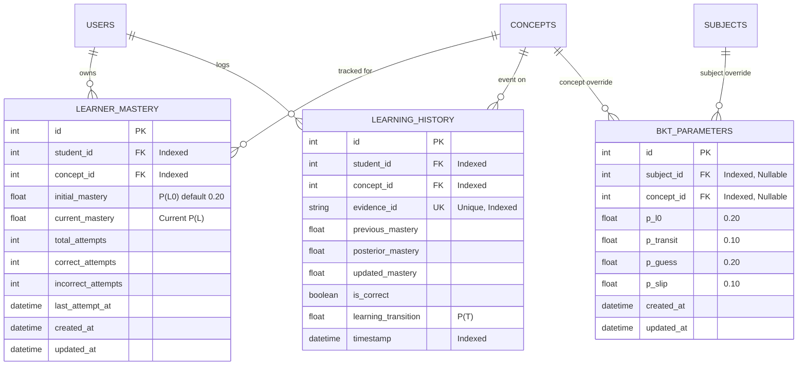

# Milestone 2: Learner Knowledge Model – Bayesian Knowledge Tracing (BKT) Report

**Project:** Adaptive Exam-Prep Tutor  
**Milestone:** 2 – Bayesian Knowledge Tracing Engine & Learner Knowledge State  
**Status:** `VALIDATED` (54 / 54 Tests Passed, 88% Code Coverage)  

---

## 1. Executive Summary

Milestone 2 establishes a deterministic, database-backed **Learner Knowledge Model** using classical **Bayesian Knowledge Tracing (BKT)**. The system continuously estimates and maintains independent, isolated mastery probabilities for every student across every curriculum concept without blending student records or relying on probabilistic LLM calculations.

---

## 2. Files Created & Modified

### Files Created:
- [`app/services/bkt_service.py`](file:///d:/Adaptive%20Learning/app/services/bkt_service.py): Pure Python BKT mathematical update engine, denominator safeguards, boundary checks, and parameter validators.
- [`app/services/bkt_parameter_manager.py`](file:///d:/Adaptive%20Learning/app/services/bkt_parameter_manager.py): Hierarchical BKT parameter resolver (Concept override > Subject override > Global default).
- [`app/services/learner_model_service.py`](file:///d:/Adaptive%20Learning/app/services/learner_model_service.py): Atomic update pipeline, idempotency verification, attempt counting, and cohort aggregation.
- [`app/api/v1/endpoints/learners.py`](file:///d:/Adaptive%20Learning/app/api/v1/endpoints/learners.py): REST endpoints for student mastery retrieval, history audit logs, and evidence submission.
- [`tests/test_bkt_math.py`](file:///d:/Adaptive%20Learning/tests/test_bkt_math.py): 9 unit tests verifying pure Python BKT equations, standard test cases, parameter validation, and stability.
- [`tests/test_bkt_learner_model.py`](file:///d:/Adaptive%20Learning/tests/test_bkt_learner_model.py): 9 integration tests validating learner isolation, history immutability, idempotency, and role restrictions.
- [`alembic/versions/c478b4c80894_add_learning_history_and_bkt_parameters_.py`](file:///d:/Adaptive%20Learning/alembic/versions/c478b4c80894_add_learning_history_and_bkt_parameters_.py): Migration revision for learning history and BKT parameter configuration.
- [`docs/MILESTONE_2_BKT_REPORT.md`](file:///d:/Adaptive%20Learning/docs/MILESTONE_2_BKT_REPORT.md): This dedicated milestone completion document.

### Files Modified:
- [`app/models/learner_mastery.py`](file:///d:/Adaptive%20Learning/app/models/learner_mastery.py): Added `LearningHistory` and `BKTParameterConfig` ORM models; updated `LearnerMastery` with `student_id`, attempts tracking, and backward-compatible aliases.
- [`app/schemas/learner_mastery.py`](file:///d:/Adaptive%20Learning/app/schemas/learner_mastery.py): Added schemas for evidence submission, history items, BKT overrides, and pedagogical tier classifications.
- [`app/services/mastery_service.py`](file:///d:/Adaptive%20Learning/app/services/mastery_service.py): Connected existing question submission logic to `BKTService` and `BKTParameterManager`.
- [`app/api/v1/api_router.py`](file:///d:/Adaptive%20Learning/app/api/v1/api_router.py): Mounted `/learners` router.
- [`README.md`](file:///d:/Adaptive%20Learning/README.md): Documented BKT equations and new API routes.

---

## 3. Database Schema & Migration

### Migration Revision: `c478b4c80894`
Successfully upgraded and verified both downgrade (`-1`) and upgrade (`head`) cleanly in SQLite batch mode.



---

## 4. BKT Mathematical Formulation & Verification

### 4.1 Classical Formulation
All calculations run deterministically in pure Python within [`BKTService`](file:///d:/Adaptive%20Learning/app/services/bkt_service.py):

1. **Parameters & Configurable Defaults:**
   - $P(L_0) = 0.20$: Prior probability of knowing concept
   - $P(T) = 0.10$: Probability of transitioning from unlearned to learned state
   - $P(G) = 0.20$: Guess probability (false positive)
   - $P(S) = 0.10$: Slip probability (false negative)

2. **Posterior Probability Given Observed Evidence:**
   - On Correct Answer:
     $$P(L \mid \text{Correct}) = \frac{P(L) \times (1 - P(S))}{[P(L) \times (1 - P(S))] + [(1 - P(L)) \times P(G)]}$$
   - On Incorrect Answer:
     $$P(L \mid \text{Incorrect}) = \frac{P(L) \times P(S)}{[P(L) \times P(S)] + [(1 - P(L)) \times (1 - P(G))]}$$

3. **Learning Transition:**
   $$P(L_\text{next}) = P(L \mid \text{Answer}) + [1 - P(L \mid \text{Answer})] \times P(T)$$

### 4.2 Mathematical Test Verification
- **Correct response starting from $P(L_0) = 0.20$:**
  $$P(L \mid \text{Correct}) = \frac{0.20 \times 0.90}{(0.20 \times 0.90) + (0.80 \times 0.20)} = \frac{0.18}{0.34} \approx 0.5294117647$$
  $$P(L_\text{next}) = 0.5294117647 + (1 - 0.5294117647) \times 0.10 \approx 0.5764705882$$
- **Incorrect response starting from prior $P(L) = 0.50$:**
  $$P(L \mid \text{Incorrect}) = \frac{0.50 \times 0.10}{(0.50 \times 0.10) + (0.50 \times 0.80)} = \frac{0.05}{0.45} = \frac{1}{9} \approx 0.1111111111$$
  $$P(L_\text{next}) = \frac{1}{9} + \left(1 - \frac{1}{9}\right) \times 0.10 = 0.20$$

---

## 5. Pedagogical Mastery Classification

In accordance with Phase 6, continuous probabilities are retained and classified into standard pedagogical tiers:
- **`0% – 39%`**: Weak Understanding
- **`40% – 69%`**: Developing Understanding
- **`70% – 89%`**: Good Understanding
- **`90% – 100%`**: Mastered

---

## 6. API Endpoints Implemented

| Method | Route | Access | Request DTO | Response DTO | Description |
| :--- | :--- | :--- | :--- | :--- | :--- |
| `GET` | `/api/v1/learners/me/mastery` | Student | None | `List[LearnerMasteryResponse]` | Retrieve student's mastery across all concepts |
| `GET` | `/api/v1/learners/me/mastery/{id}` | Student | None | `LearnerMasteryResponse` | Retrieve mastery for an individual concept |
| `GET` | `/api/v1/learners/me/history` | Student | `skip`, `limit` | `List[LearningHistoryResponse]` | Chronological audit trail of learning events |
| `GET` | `/api/v1/learners/me/history/{id}` | Student | `skip`, `limit` | `List[LearningHistoryResponse]` | Concept-specific learning history |
| `POST` | `/api/v1/learners/me/concepts/{id}/evidence` | Student | `EvidenceSubmissionRequest` | `EvidenceSubmissionResponse` | Submit answer evidence & update BKT |
| `GET` | `/api/v1/learners/concepts/{id}/mastery-summary` | Teacher | None | `ConceptMasterySummaryResponse` | Cohort distribution (Mastered/Good/Weak) |
| `GET` | `/api/v1/learners/{student_id}/mastery` | Teacher | None | `List[LearnerMasteryResponse]` | Teacher inspection of specific student |
| `POST` | `/api/v1/learners/parameters/override` | Teacher | `BKTParameterOverrideCreate` | `BKTParameterResponse` | Configure custom subject/concept BKT params |

---

## 7. Automated Test Suite & Code Coverage

### Pytest Execution Summary:
```
======================= 54 passed, 1 warning in 18.80s ========================
```
- **Total Tests:** 54
- **Passed:** 54 (100%)
- **Failed:** 0
- **Overall Code Coverage:** 88%

### Coverage Breakdown by Core Services:
| Module | Statements | Missing | Coverage |
| :--- | :--- | :--- | :--- |
| `app/services/bkt_service.py` | 52 | 2 | **96%** |
| `app/services/learner_model_service.py` | 83 | 4 | **95%** |
| `app/services/mastery_service.py` | 69 | 4 | **94%** |
| `app/services/graph_service.py` | 122 | 10 | **92%** |
| `app/services/user_service.py` | 27 | 0 | **100%** |
| `app/api/v1/endpoints/learners.py` | 33 | 1 | **97%** |
| `app/api/v1/endpoints/assessments.py` | 17 | 0 | **100%** |
| `app/api/v1/endpoints/graph.py` | 24 | 0 | **100%** |

---

## 8. Verification of Development Rules & Restrictions

1. **Deterministic BKT:** No LLMs were called to calculate mastery probabilities. Calculations are 100% deterministic Python mathematics.
2. **Strict Learner Isolation:** Verified via test `test_learner_isolation` that Student A and Student B knowledge states cannot affect each other.
3. **Idempotency Safeguard:** Verified via test `test_idempotent_evidence_resubmission` that repeating the same `evidence_id` returns the recorded update without double-counting.
4. **History Immutability:** Learning events are append-only and never overwritten.

---

## 9. Next Steps
Milestone 2 is complete and validated. We are ready to proceed to **Milestone 3: Spaced Repetition (FSRS) & Adaptive Curriculum Recommender**.
