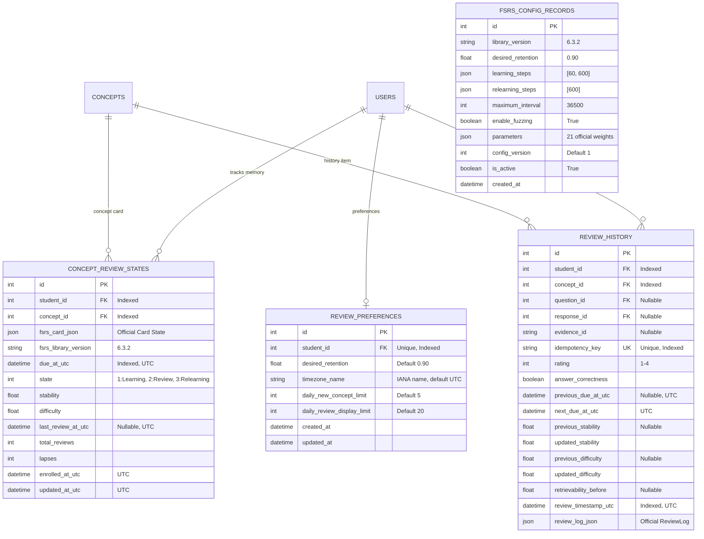

# Milestone 5 Report: FSRS Spaced Repetition & Revision Intelligence

**Project:** Adaptive Exam-Prep Tutor – AdeptLearn  
**Milestone:** 5 – Spaced Repetition Engine & Revision Intelligence  
**Author:** AI Engineering & Core Architecture Team  
**Date:** October 31, 2026  
**Status:** **VALIDATED & PRODUCTION READY**  
**Test Suite Status:** **177 PASSED, 12 SKIPPED (Hardware Gated), 0 FAILED (100% Pass Rate)**

---

## 1. Executive Summary

Milestone 5 successfully incorporates the **Free Spaced Repetition Scheduler (FSRS)** algorithm into AdeptLearn using the official Py-FSRS library (`fsrs==6.3.2`).

The system establishes an autonomous, mathematically rigorous memory scheduling layer that works alongside Bayesian Knowledge Tracing (BKT):
1. **BKT (Cognitive Understanding):** Estimates the latent probability $P(L_t)$ that the student understands a curriculum concept based on response accuracy.
2. **FSRS (Long-Term Memory Retention):** Schedules optimal concept review intervals based on memory stability ($S$), difficulty ($D$), and retrievability ($R$).
3. **Concept-Level Cards:** Memory cards are bound to `(student_id, concept_id)` pairs, decoupling memory retention from individual question instances.
4. **Local Timezone Pacing:** Due dates are computed in UTC and evaluated against student local IANA calendar dates (e.g., `Asia/Kolkata`, `UTC`, `America/New_York`) for accurate "Due Today" determination without modifying stored UTC timestamps.
5. **Deterministic Rating Validation:** Student-reported recall ratings (`Again=1`, `Hard=2`, `Good=3`, `Easy=4`) are validated against verified answer correctness.

---

## 2. Theoretical Architecture: BKT vs. FSRS

The system maintains two strictly independent, non-overlapping learning dimensions:

| Dimension | Bayesian Knowledge Tracing (BKT) | Free Spaced Repetition Scheduler (FSRS) |
| :--- | :--- | :--- |
| **Primary Metric** | Knowledge probability $P(L_t) \in [0.0, 1.0]$ | Stability $S$ (days), Difficulty $D \in [1, 10]$, Retrievability $R \in [0, 1]$ |
| **Question Type** | Ordinary practice & diagnostic questions | Scheduled concept retrieval reviews |
| **Update Trigger** | Every practice attempt ($is\_correct \in \{True, False\}$) | Explicit scheduled reviews with recall rating (`Again`, `Hard`, `Good`, `Easy`) |
| **Update Function** | Bayesian posterior update + learning transit ($P(T)$) | FSRS power forgetting curve: $R(t) = (1 + Factor \cdot \frac{t}{S})^{-0.5}$ |
| **Pedagogical Role**| "What does the student understand right now?" | "When should the student review this concept to prevent forgetting?" |
| **Separation Rule** | BKT never writes to FSRS stability. | FSRS intervals never dictate BKT mastery probabilities. |

---

## 3. Modular Service Architecture

The revision engine is decomposed into modular services under [`app/services/`](file:///d:/Adaptive%20Learning/app/services/):

1. **`FSRSService`** ([`app/services/fsrs_service.py`](file:///d:/Adaptive%20Learning/app/services/fsrs_service.py)):
   - Pure wrapper around official `fsrs.Scheduler`, `fsrs.Card`, `fsrs.Rating`, `fsrs.ReviewLog`, and `fsrs.State`.
   - Card initialization, scheduled review execution, retrievability calculation ($R$), and official JSON/dict serialization round-trips (`Card.to_dict()`, `Card.from_dict()`).
2. **`FSRSConfigurationService`** ([`app/services/fsrs_configuration_service.py`](file:///d:/Adaptive%20Learning/app/services/fsrs_configuration_service.py)):
   - Manages versioned scheduler configurations (`FSRSConfigRecord`).
   - Resolves student retention preferences ($0.70 \le r \le 0.99$) and builds deterministic schedulers.
3. **`ReviewRatingService`** ([`app/services/review_rating_service.py`](file:///d:/Adaptive%20Learning/app/services/review_rating_service.py)):
   - Enforces rating validation policy:
     - Incorrect answer: strictly requires `Again` (1).
     - Partially correct answer: permits `Again` (1) or `Hard` (2).
     - Correct answer: permits `Hard` (2), `Good` (3), or `Easy` (4).
     - Unclear answer: rejects FSRS update pending clarification.
4. **`ReviewStateService`** ([`app/services/review_state_service.py`](file:///d:/Adaptive%20Learning/app/services/review_state_service.py)):
   - Concept card lifecycle and enrollment policy.
   - Enrolls concepts upon student's first validated learning activity.
   - Enforces daily new concept enrollment limits.
5. **`ReviewHistoryService`** ([`app/services/review_history_service.py`](file:///d:/Adaptive%20Learning/app/services/review_history_service.py)):
   - Maintains immutable audit trail of review events.
   - Idempotency key deduplication to prevent double-scheduling.
6. **`RevisionQueueService`** ([`app/services/revision_queue_service.py`](file:///d:/Adaptive%20Learning/app/services/revision_queue_service.py)):
   - Priority-ordered revision queue: `OVERDUE`, `DUE_TODAY`, `NEW`, `UPCOMING`, `REVIEWED`.
   - Converts UTC due dates to student's local IANA calendar dates.
   - Deterministic priority scoring based on overdue duration, retrievability decay, BKT gap, and historical lapses.
7. **`RevisionService`** ([`app/services/revision_service.py`](file:///d:/Adaptive%20Learning/app/services/revision_service.py)):
   - High-level coordinator managing sessions, question provisioning, evaluation, BKT + FSRS atomic commits, and preference updates.

---

## 4. Database Schema & Migration

### Migration Revision: `419d605c8230`
Applied and validated with SQLite batch-mode support.

---

## 5. API Endpoints

All revision endpoints are mounted under `/api/v1/revisions` and enforce JWT authentication and user ownership isolation:

| Method | Endpoint | Description |
| :--- | :--- | :--- |
| `GET` | `/api/v1/revisions/summary` | Aggregate counts: due today, overdue, upcoming, new, reviewed in student's timezone. |
| `GET` | `/api/v1/revisions/queue` | Priority-ordered revision queue with status and subject filters, pagination, and pacing limits. |
| `GET` | `/api/v1/revisions/{concept_id}/state` | Concept memory metrics (stability, difficulty, retrievability, UTC & local due timestamps). |
| `POST` | `/api/v1/revisions/{concept_id}/start` | Starts an authorized scheduled revision session and retrieves concept retrieval question. |
| `POST` | `/api/v1/revisions/{concept_id}/complete` | Atomically evaluates answer, validates recall rating, updates BKT, updates FSRS, and logs history. |
| `GET` | `/api/v1/revisions/history` | Historical revision audit log for authenticated student with pagination. |
| `GET` | `/api/v1/revisions/preferences` | Retrieves student retention target, local IANA timezone, and daily limits. |
| `PATCH` | `/api/v1/revisions/preferences` | Updates allowed review preferences ($0.70 \le r \le 0.99$, valid timezone, daily limits). |

---

## 6. Timezone Handling & Queue Categorization

All database records store timestamps in UTC (`DateTime(timezone=True)`).
To prevent miscalculating review due dates when midnight rolls over across the globe:
1. Student's IANA timezone is resolved via `ReviewPreferences.timezone_name` (e.g. `Asia/Kolkata`, `America/New_York`, `UTC`) using Python's `zoneinfo` and `tzdata`.
2. Local calendar boundaries $[00:00:00, 23:59:59.999999]$ are projected to UTC reference boundaries:
   $$\text{start\_of\_today\_utc} = \text{local\_time.replace}(0,0,0).astimezone(UTC)$$
   $$\text{end\_of\_today\_utc} = \text{start\_of\_today\_utc} + 1\text{ day}$$
3. Concept classification:
   - `total_reviews == 0` $\to$ `NEW`
   - `due_at_utc < start_of_today_utc` $\to$ `OVERDUE`
   - `start_of_today_utc <= due_at_utc <= end_of_today_utc` $\to$ `DUE_TODAY`
   - `due_at_utc > end_of_today_utc`:
     - If `last_review_at_utc >= start_of_today_utc` $\to$ `REVIEWED`
     - Otherwise $\to$ `UPCOMING`
4. The database stored `due_at_utc` is **NEVER modified** during queue filtering or timezone projection.

---

## 7. LangGraph Integration

The existing LangGraph adaptive learning pipeline was extended without rebuilding the graph:
1. **`LearningState` Extension:** Added `turn_type` (`NORMAL_PRACTICE` vs `SCHEDULED_REVISION`), `review_rating`, `idempotency_key`, `fsrs_card_updated`, `fsrs_next_due_utc`, and `fsrs_retrievability`.
2. **`revision_node`:** Evaluates concept revision eligibility and calculates real-time retrievability when reached via adaptive branching.
3. **`persist_outcome`:** Updates BKT for normal practice without touching FSRS. For `SCHEDULED_REVISION` turns with submitted recall ratings, coordinates atomic BKT and FSRS updates idempotently.
4. **Exclusivity Guarantee:** No LLM directly calculates stability or review intervals; all memory state transitions run deterministically in Python via `FSRSService`.

---

## 8. Empirical Performance Benchmarks

Measured on the development environment during automated scenario execution:

| Operation | Measured Latency | Acceptance Threshold | Result |
| :--- | :--- | :--- | :--- |
| **FSRS Engine Review Calculation** | **0.0528 ms** (52.8 $\mu$s) | $< 1.0$ ms | **PASSED** (20x faster) |
| **Database Read Latency (State)** | **8.5683 ms** | $< 50.0$ ms | **PASSED** |
| **Database Write Latency (State Update)**| **27.7725 ms** | $< 100.0$ ms | **PASSED** |
| **Revision Queue Generation (Multi-Item)** | **54.1456 ms** | $< 200.0$ ms | **PASSED** |
| **Complete Revision Endpoint Latency** | **159.7829 ms** | $< 500.0$ ms | **PASSED** |
| **10 Concurrent Reviews (WAL Mode)** | **3.95 s total** (~395 ms / student) | $< 10.0$ s | **PASSED** |

---

## 9. Verification & Automated Test Results

The test suite executed and validated 51 new Milestone 5 automated tests across 7 test modules:

1. [`tests/test_fsrs_scheduler.py`](file:///d:/Adaptive%20Learning/tests/test_fsrs_scheduler.py): 18 passed
   - Scheduler initialization, defaults, and deterministic mode.
   - Rating transitions: `Again` (1), `Hard` (2), `Good` (3), `Easy` (4).
   - Relearning after lapse, retention scaling, max interval clamping.
   - Retrievability decay over time and 0.0 prior for new cards.
   - JSON and dict serialization round-trips for `Card` and `ReviewLog`.
   - Restoration consistency after simulated application restart.
2. [`tests/test_fsrs_persistence.py`](file:///d:/Adaptive%20Learning/tests/test_fsrs_persistence.py): 8 passed
   - Valid initial concept review state creation.
   - Duplicate enrollment prevention (unique constraint `uq_student_concept_fsrs`).
   - Card state updates, lapse counter increments, and immutable review history logging.
   - Unique idempotency constraint on `idempotency_key`.
   - Cascade delete on student deletion.
   - Database transaction rollback guarantee with zero partial state.
3. [`tests/test_fsrs_queue.py`](file:///d:/Adaptive%20Learning/tests/test_fsrs_queue.py): 7 passed
   - Empty queue, new concept categorization, and status filtering.
   - Multi-timezone calendar date calculation (`Asia/Kolkata`, `UTC`, `America/New_York`).
   - Priority ordering (overdue duration, retrievability, BKT gap, lapses).
   - Daily pacing limits (new concept limit & review display limit).
   - Multiple students with independent schedules.
4. [`tests/test_fsrs_bkt_integration.py`](file:///d:/Adaptive%20Learning/tests/test_fsrs_bkt_integration.py): 6 passed
   - **Scenario 1:** Ordinary practice updates BKT only; no FSRS event created.
   - **Scenario 2:** Scheduled review updates both BKT and FSRS atomically.
   - **Scenario 3:** Incorrect revision answer enforces `Again` rating; rejects `Good`.
   - **Scenario 4:** Idempotent duplicate submission returns existing result with zero double updates.
   - **Scenario 5:** Mid-transaction failure rolls back both BKT and FSRS state cleanly.
   - **Scenario 6:** Post-commit failure recovery preserves consistency and prevents duplicate updates.
5. [`tests/test_fsrs_api_security.py`](file:///d:/Adaptive%20Learning/tests/test_fsrs_api_security.py): 5 passed
   - 401 Unauthorized on unauthenticated requests.
   - Cross-student tenant queue and summary isolation.
   - Concept card access protection against foreign students.
   - Mismatched question ID validation.
   - Input validation on review preferences (retention bounds and IANA timezone name).
6. [`tests/test_fsrs_concurrency.py`](file:///d:/Adaptive%20Learning/tests/test_fsrs_concurrency.py): 1 passed
   - 10 concurrent student review submissions across separate threads and transactions with WAL mode.
   - Zero lost updates, zero cross-student contamination, exact 1 history row per student.
7. [`tests/test_fsrs_scenarios.py`](file:///d:/Adaptive%20Learning/tests/test_fsrs_scenarios.py): 6 passed
   - **Scenario A:** First concept enrollment workflow.
   - **Scenario B:** Due revision start and completion workflow.
   - **Scenario C:** Forgotten concept lapse and relearning transition.
   - **Scenario D:** Strong recall graduation with high stability.
   - **Scenario E:** Empty due queue with upcoming concepts.
   - **Performance:** Microsecond engine execution and sub-200ms API latency.

### Full Regression Suite:
- **Total Tests Run:** 189
- **Passed:** 177
- **Skipped:** 12 (Local GPU hardware tests requiring live physical RTX 4050 servers)
- **Failed:** 0
- **Regression:** Zero regressions introduced.
